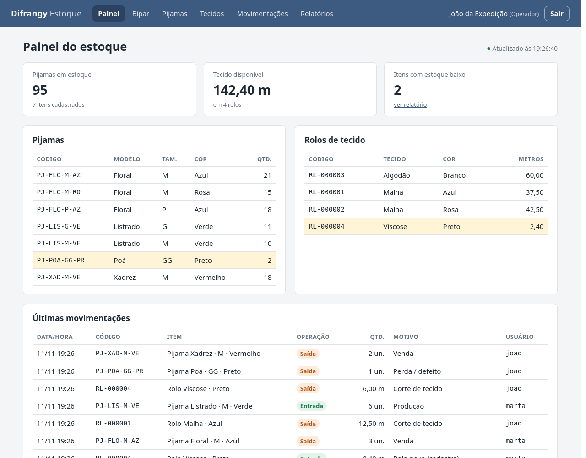
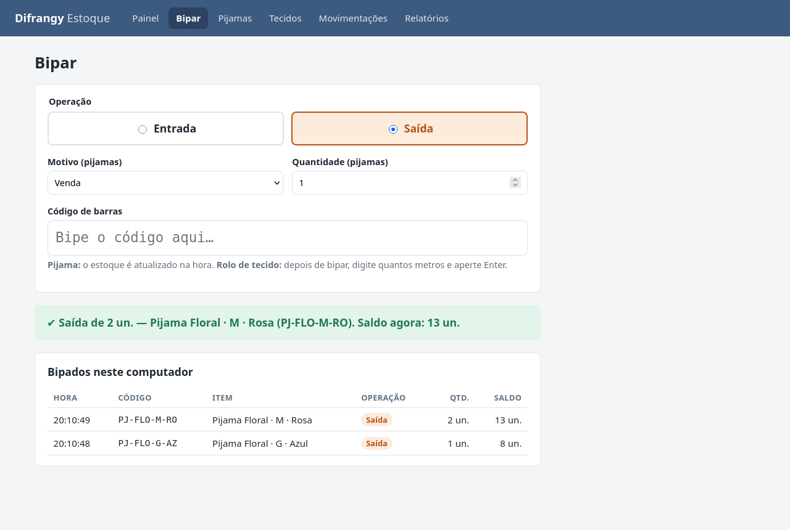
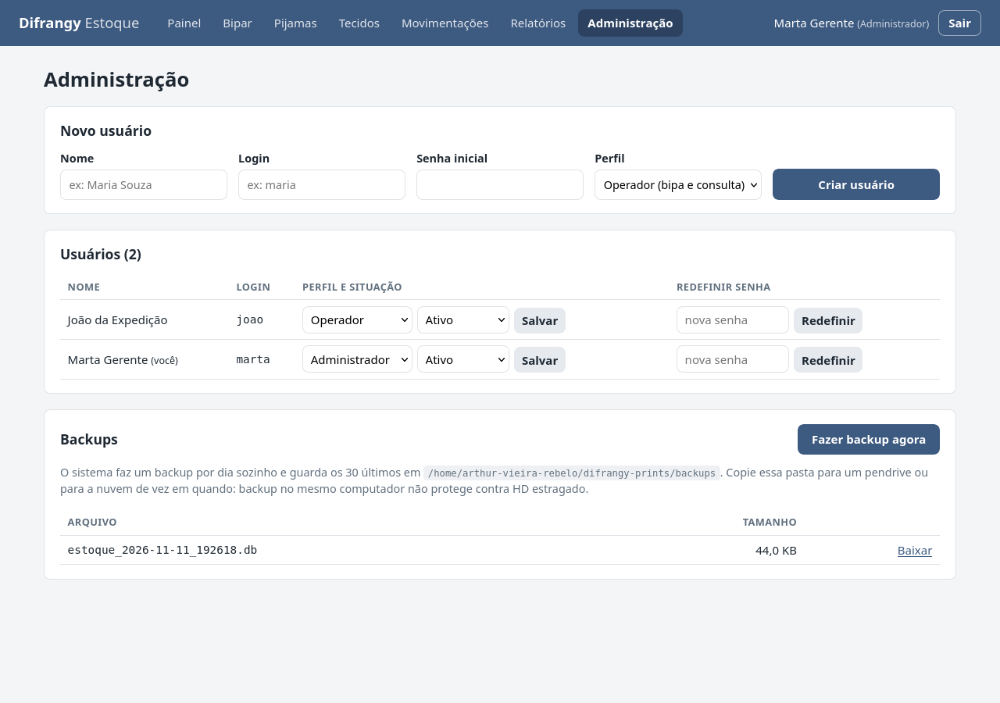
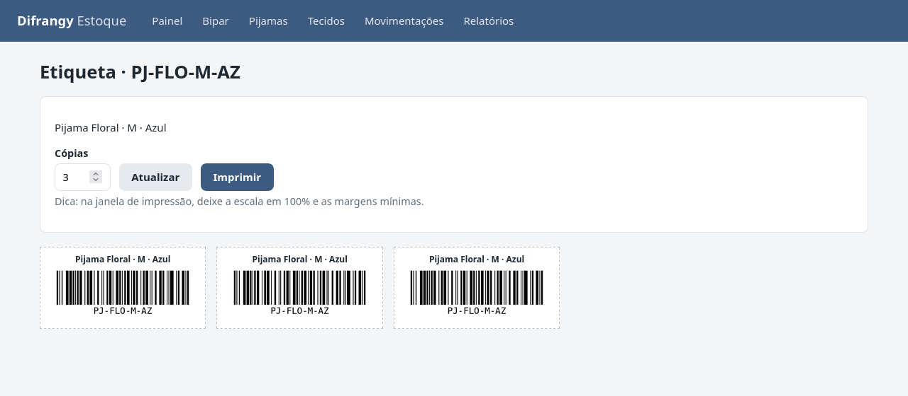
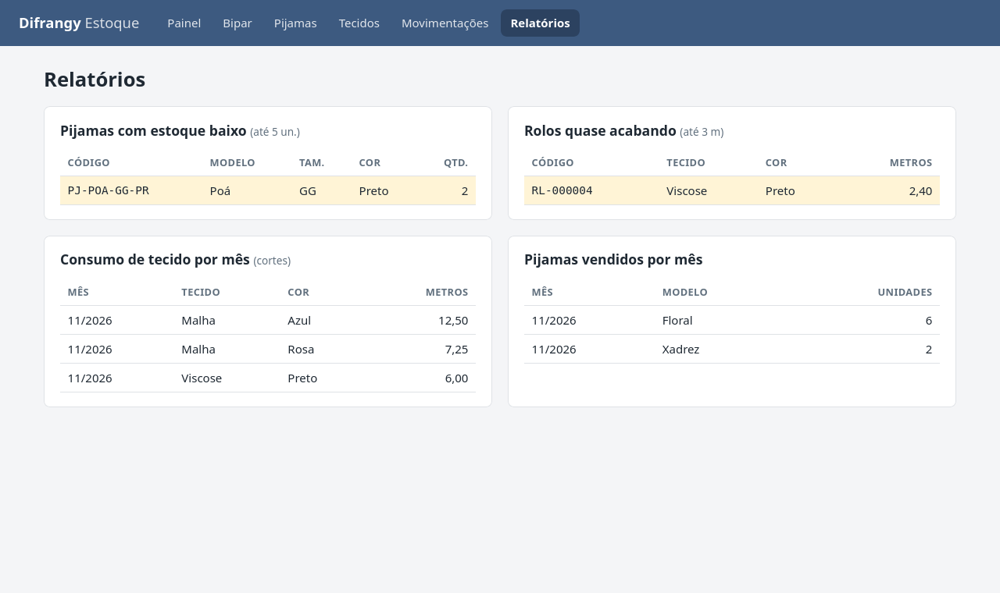

# Difrangy Estoque

Sistema web de controle de estoque com leitura de código de barras, feito para uma fábrica de pijamas. Controla o produto acabado (pijamas, em unidades) e a matéria-prima (rolos de tecido, em metros), com histórico completo de cada entrada e saída.

É um sistema de uso interno: roda num computador da fábrica e é acessado pelo navegador dos outros computadores da mesma rede.



## Funcionalidades

- **Leitura por código de barras** com leitor USB ou sem fio comum. Nenhum driver é necessário.
- **Pijamas por SKU:** cada combinação de modelo, tamanho e cor tem seu próprio código (ex.: `PJ-FLO-M-AZ`).
- **Rolos de tecido individuais:** cada rolo recebe uma etiqueta própria (`RL-000001`). No corte, basta bipar o rolo e informar quantos metros foram usados.
- **Painel em tempo real:** qualquer computador com o painel aberto vê as movimentações feitas nos outros em até 3 segundos, sem recarregar a página.
- **Etiquetas prontas para impressão** em código de barras (Code128) ou QR code, geradas em lote pelo próprio sistema. Funcionam em folha A4 ou impressora térmica.
- **Histórico de movimentações** com data, motivo, usuário responsável e filtro por código.
- **Relatórios:** itens com estoque baixo, consumo de tecido por mês e pijamas vendidos por mês.
- **Estoque baixo por pijama:** cada pijama tem o seu limite de alerta, porque os que vendem mais precisam de aviso mais cedo.
- **Login por funcionário**, com perfis de administrador e operador.
- **Edição, desativação e exclusão de itens** sem perder o histórico.
- **Exportação em CSV** do estoque, do histórico e dos relatórios, formatada para o Excel em português.
- **Backup automático diário** do banco de dados, com download pela própria interface.
- **Tema claro e escuro**, que segue a preferência do sistema operacional até o usuário escolher um tema.

## Como o estoque é controlado

O saldo de um item nunca é alterado diretamente. Toda entrada ou saída grava uma linha na tabela `movimentacoes` com data e motivo (produção, venda, perda/defeito, ajuste de inventário ou corte de tecido). A atualização do saldo e o registro no histórico acontecem na mesma transação: ou as duas operações são salvas, ou nenhuma.

O estoque nunca fica negativo. A conferência do saldo é feita dentro do próprio `UPDATE` (`WHERE quantidade + ? >= 0`), e não numa consulta separada antes. Assim, dois computadores não conseguem dar baixa na última unidade ao mesmo tempo. As tabelas também têm restrições `CHECK` como segunda camada de proteção.

## Leitura do código de barras

Leitores de código de barras USB funcionam como um teclado: digitam o código e enviam `Enter`. A tela de leitura aproveita isso com um campo de texto sempre focado dentro de um formulário. O JavaScript intercepta o envio, manda o código para a API com `fetch()` e mostra o resultado na própria página. Um sinal sonoro indica sucesso ou erro, para quem está bipando sem olhar para a tela.

O mesmo campo aceita digitação manual. Enquanto a pessoa digita, uma lista sugere os itens que combinam pelo código ou pela descrição ("floral azul" encontra os pijamas Floral azuis), e as setas ↑ ↓ com Enter escolhem um item. A digitação é tolerante: letras minúsculas, acentos e a falta de hífens são corrigidos automaticamente (`pjflomaz` → `PJ-FLO-M-AZ`, `rl12` → `RL-000012`). Essa correção acontece no servidor, então vale também para quem usa a API. O Enter só seleciona uma sugestão quando ela foi escolhida com as setas, para não interferir no leitor.

| Item bipado | O que acontece |
|---|---|
| Pijama | A movimentação é registrada na hora, com a quantidade e o motivo selecionados. |
| Rolo de tecido | O sistema mostra o rolo e a metragem atual e pede quantos metros foram usados. |



## Usuários e permissões

Cada funcionário entra com o próprio login, e toda movimentação fica registrada com o usuário que a fez. A sessão dura 12 horas, o equivalente a um turno, para que ninguém precise digitar a senha a cada bipe.

| Ação | Operador | Administrador | Master |
|---|:---:|:---:|:---:|
| Bipar entradas e saídas | ✓ | ✓ | ✓ |
| Consultar painel, histórico e relatórios, exportar CSV, imprimir etiquetas | ✓ | ✓ | ✓ |
| Ajuste de inventário | | ✓ | ✓ |
| Cadastrar, editar, desativar e excluir pijamas e rolos | | ✓ | ✓ |
| Definir o limite de estoque baixo de cada pijama | | ✓ | ✓ |
| Gerenciar usuários e backups | | ✓ | ✓ |
| Configurações do sistema (tipos de etiqueta liberados) | | | ✓ |

Na primeira execução, o sistema pede a criação da conta do **master**: o administrador dono do sistema. Ele é o único que altera as configurações, e nenhum outro usuário pode desativá-lo, rebaixá-lo ou redefinir sua senha. Em bancos de versões anteriores, o administrador mais antigo é promovido a master automaticamente.

As senhas são armazenadas apenas como hash (scrypt, via Werkzeug). O sistema impede que o último administrador ativo seja desativado ou rebaixado.

Excluir um item exige dois passos: primeiro desativá-lo, depois excluí-lo na tela de edição. Um item desativado deixa de aparecer no painel e recusa movimentações. As movimentações de um item excluído continuam no histórico e nos relatórios, identificadas como "(item excluído)", para que os totais de meses anteriores não mudem. O código de um pijama excluído não pode ser reutilizado.



## Tecnologias

| Camada | Tecnologia |
|---|---|
| Back-end | Python 3, Flask, servido pelo Waitress |
| Banco de dados | SQLite (módulo `sqlite3`, SQL escrito à mão, modo WAL) |
| Código de barras e QR code | python-barcode (Code128), qrcode, Pillow |
| Front-end | HTML com templates Jinja, CSS e JavaScript sem frameworks |
| Testes | `unittest` da biblioteca padrão |

A escolha por SQLite e SQL sem ORM foi intencional: o volume de dados de uma fábrica pequena cabe tranquilamente num único arquivo, e a instalação não depende de um servidor de banco de dados.

## Estrutura

```
.
├── app.py              # rotas, login e permissões
├── banco.py            # acesso ao banco e regras de estoque
├── usuarios.py         # cadastro de usuários e verificação de senha
├── backup.py           # cópias de segurança automáticas
├── exportacao.py       # geração dos arquivos CSV
├── configuracoes.py    # configurações do sistema (alteradas pelo master)
├── etiquetas.py        # imagens do código de barras e do QR code
├── templates/          # páginas HTML (Jinja)
├── static/
│   ├── css/estilo.css
│   └── js/             # comum.js, painel.js (atualização), bipar.js (leitura)
├── testes/             # testes automatizados
└── requirements.txt
```

## Instalação

Requisitos: Python 3.10 ou mais recente.

```bash
git clone https://github.com/ArthurVieiraRebelo/difrangy-estoque.git
cd difrangy-estoque

python3 -m venv .venv
source .venv/bin/activate          # Windows: .venv\Scripts\activate
pip install -r requirements.txt
```

## Execução

```bash
python app.py
```

O terminal mostra os dois endereços de acesso: `http://localhost:5000`, para o próprio computador, e `http://<IP na rede>:5000`, para os demais. Se a página não abrir nos outros computadores, verifique se o firewall libera a porta 5000.

Na primeira execução são criados automaticamente:

| Arquivo | Conteúdo |
|---|---|
| `estoque.db` | o banco de dados |
| `.chave_secreta` | a chave que assina os cookies de login |
| `backups/` | as cópias diárias do banco (as 30 mais recentes) |

Os três ficam fora do Git e não devem ser compartilhados.

Para usar outra porta, defina a variável de ambiente `ESTOQUE_PORTA` (ex.: `ESTOQUE_PORTA=8080 python app.py`). Se a porta já estiver em uso, o sistema avisa e não inicia, o que normalmente significa que ele já está aberto em outro terminal.

## Testes

```bash
python -m unittest -v
```

Os testes cobrem as regras de estoque (saldo negativo, arredondamento de metragem, códigos duplicados ou reservados), login e permissões por perfil, a exportação CSV, o backup, as rotas da API e a renderização das páginas. Cada teste usa um banco temporário próprio, então o estoque real nunca é tocado.

## Códigos e etiquetas

| Tipo | Formato | Exemplo |
|---|---|---|
| Pijama | `PJ-<modelo>-<tamanho>-<cor>` | `PJ-FLO-M-AZ` = Floral, M, Azul |
| Rolo | `RL-<número sequencial>` | `RL-000042` |

O código do pijama é gerado a partir das primeiras letras do modelo e da cor, sem acentos, e pode ser digitado manualmente no cadastro. O prefixo `RL-` é reservado para rolos.

O cadastro é feito numa janela modal. O item recém-cadastrado já volta marcado na lista. Para imprimir, marque um ou vários itens e escolha **Gerar código de barras** ou **Gerar QR code**. A página de impressão permite definir o número de cópias de cada item. O master pode desligar qualquer um dos dois botões nas configurações do sistema.

Os dois formatos guardam o mesmo texto, o código do item, e funcionam igualmente na tela Bipar. Leitores laser comuns leem apenas código de barras. Para ler QR code é necessário um leitor de imagem (2D).



## Relatórios



Um item aparece como estoque baixo quando o saldo fica igual ou menor que o limite dele.

- **Pijamas:** cada um tem o seu limite, definido pelo administrador no cadastro ou na tela de edição (campo *Estoque baixo com até*). Um pijama que vende muito pode avisar com 30 unidades, e um que vende pouco, com 2. Com limite 0, o aviso aparece só quando o pijama acaba. Pijama novo vem com 5, valor da constante `LIMITE_PIJAMAS_BAIXO` em `banco.py`.
- **Rolos de tecido:** um limite único de 3 metros para todos, na constante `LIMITE_METROS_BAIXO`.

O painel, a lista de pijamas e o relatório usam o limite de cada pijama, e a exportação CSV inclui essa coluna.

## Limitações conhecidas

- **Sem HTTPS.** O sistema foi feito para a rede interna. As senhas trafegam sem criptografia entre o navegador e o servidor, então não exponha a porta 5000 à internet.
- **Backup no mesmo computador.** O backup automático protege contra exclusão acidental e dados corrompidos, mas não contra falha do disco. Copie a pasta `backups/` para outro lugar periodicamente.
- **Sem limite de tentativas de login.** Aceitável numa rede interna, mas necessário antes de qualquer acesso externo.

## Próximos passos

- Limite de tentativas de login
- Contagem de inventário guiada pelo leitor, com relatório de divergências
- Cópia automática dos backups para outro computador ou para a nuvem

## Licença

Distribuído sob a licença MIT. Veja o arquivo [LICENSE](LICENSE).
